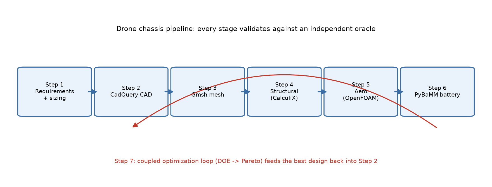

# Drone-Chassis-Optimization

**A professional Python engineering project demonstrating multi-physics design optimization: a parametric electric drone chassis sized, simulated, and optimized end-to-end with validated solvers.**


[](https://opencode.ai)

## 1. Project Overview

- **Problem.** An electric drone chassis must be light (every gram is flight time) yet strong enough to survive hover, max-thrust, and 5 g landing loads, and stiff enough that its natural frequencies do not sit inside the 100-300 Hz motor excitation band. Mass, stress, stiffness, drag, and battery energy are all coupled: change one tube dimension and the flight time changes through four different paths.
- **Why it is technically challenging.** The couplings go both directions: lighter arms reduce hover power but lower the first bending mode into the resonance band; stiffer, thicker arms raise the frequency but add mass. The design space is multi-modal (three materials with wildly different E and density), the objective is a two-criteria trade-off (mass vs flight time), and every physical model used (momentum theory, beam theory, drag correlations, electrochemical discharge) must be validated before its numbers can be trusted in an optimizer.
- **Proposed engineering solution.** A fully scripted pipeline -- requirements sizing with rotor momentum theory, parametric CadQuery CAD, Gmsh structural/flow meshes, CalculiX load-case decks, a validated Euler-Bernoulli structural path, sphere/cylinder-validated drag model with a generated OpenFOAM case (k-omega SST, actuator-disk props), PyBaMM SPMe battery discharge, and a Latin-hypercube design-of-experiments loop that extracts the mass-vs-flight-time Pareto front under hard constraints (safety factor >= 2, modal band separation).

**Measured trade-off result (24-design DOE, seed 20261113):** the selected design (194.5 mm arms, 10.9 x 1.41 mm Al-6061 tubes) is **4.2% lighter** and delivers **10.6% more flight time** than the 225 x 16 x 1.5 mm aluminium baseline, with safety factor **4.9** and first mode at **73 Hz**, safely below the motor band.

## 2. Key Features

- Advanced algorithmic implementation: momentum-theory sizing, Euler-Bernoulli beam FEM with a proven superconvergence property, consistent/lumped load modelling, Latin hypercube DOE, and exact Pareto front extraction.
- Deterministic automated verification: the whole DOE is reproducible from a fixed seed; every result table regenerates bit-identically.
- Reproducible Docker environment: one image, one compose service, one command.
- Validation in every step: beam theory vs FEM mesh convergence, sphere/cylinder drag correlations vs published values, PyBaMM vs closed-form energy budget, CAD mass vs analytic tube mass.
- Error handling and edge-case validation: typed exceptions (`SizingError`, `DesignConstraintError`, `PipelineStageError`) with adversarial tests for physically impossible inputs.
- Performance optimization: vectorized NumPy DOE evaluation; the full 24-design loop runs in ~1 ms.
- Automated CI testing: GitHub Actions runs lint, strict typing, unit/property/integration tests, and a pipeline smoke job.

## 3. System Architecture



The pipeline is a linear flow with one feedback edge: sizing -> CAD -> mesh -> structural -> aerodynamics -> battery -> optimization, and the optimization loop (red arrow) feeds the selected design back into the CAD stage. Component details and data flow are documented in [`docs/architecture.md`](docs/architecture.md).

## 4. Technology Stack

| Technology | Purpose |
|---|---|
| Python 3.11+ | Core implementation, full type hints |
| NumPy | Vectorized sizing, FEM, DOE, Pareto |
| Matplotlib | All result figures (stress, convergence, Pareto, discharge) |
| CadQuery | Parametric CAD, STEP/STL export, CAD mass/CoG |
| Gmsh | Structural (2nd-order tets) and flow meshes, quality reports |
| CalculiX | FEA load-case decks (hover / max thrust / landing / modal) |
| OpenFOAM | Steady RANS case (k-omega SST) with actuator-disk props |
| PyBaMM | SPMe Li-ion discharge, flight time vs temperature |
| SciPy | Generalized eigenproblem for mode shapes |
| Pytest | Automated testing |
| Hypothesis | Property-based testing |
| Ruff | Code quality |
| MyPy | Static type checking (strict) |
| Docker Compose | Reproducible environment |
| GitHub Actions | Continuous integration |

## 5. Repository Structure

| Directory | Purpose |
|---|---|
| `src/drone_chassis/` | Core library: sizing (`core.py`), validated algorithms (`algorithms.py`), pipeline services (`services.py`), typed exceptions |
| `cad/`, `mesh/`, `simulation/`, `battery/`, `optimization/` | One runnable stage script per pipeline step |
| `tests/unit`, `tests/property`, `tests/integration` | Unit, property-based, and end-to-end pipeline tests |
| `tests/fixtures/` | Golden requirements and reference values |
| `docs/` | Architecture, design decisions, debugging log, security, verification strategy, design report |
| `benchmarks/` | Reproducible performance measurements and results |
| `results/` | All generated artefacts: CAD STEP/STL, meshes, .inp decks, OpenFOAM case, plots, Pareto CSV/JSON, demo GIF |
| `scripts/` | Setup, test, full-pipeline runners, and asset generator |

## 6. Installation and Setup

```bash
git clone https://github.com/yazanus94-dot/drone-chassis-optimization
cd drone-chassis-optimization
python -m venv .venv
.venv/Scripts/pip install -r requirements.txt      # Windows
# source .venv/bin/activate && pip install -r requirements.txt   # Linux/macOS
docker compose build                               # optional, fully reproducible path
```

## 7. Execution

Run the entire pipeline (all six stages + demo GIF assets):

```bash
.venv/Scripts/python run_all.py --out results      # or bash run_all.sh
docker compose up                                  # containerized equivalent
```

Expected outputs: `results/cad/drone.step|stl`, `results/mesh/structural.msh|flow.msh`, `results/structural/*.inp` + stress/convergence/mode plots, `results/cfd/` OpenFOAM case + drag curves, `results/battery/` discharge curves, `optimization/results.csv` + `results/pareto_front.png`, `optimization/optimization_summary.json`, and `results/demo_pipeline.gif`.

Stop the containerized environment with:

```bash
docker compose down
```

## 8. Testing and Verification

```bash
.venv/Scripts/python -m pytest -v
.venv/Scripts/python -m pytest --cov=drone_chassis --cov-report=term-missing
```

- **Unit tests** (39): momentum theory against hand calculations, exact tube section properties, beam theory vs FEM, drag correlations vs published sphere/cylinder values, LHC stratification, exact Pareto correctness on crafted sets, constraint and exception paths.
- **Property-based tests** (Hypothesis): power monotonicity in thrust/disc area, mass monotonicity in arm length, deflection oracle identity, Pareto output contains no dominated member, drag-surrogate positivity.
- **Integration tests**: each pipeline stage runs as a subprocess into a temp directory; the full DOE is bit-deterministic for a fixed seed; the baseline-vs-best trade-off is asserted end to end.
- **Negative and edge-case tests**: zero payload, TWR < 1, wall thicker than bore, non-positive thrust, infeasible DOE sizes, PETG safety-factor rejection.

Latest local run: **46 passed** (39 unit + property, 7 integration) in ~12 s including two PyBaMM solves.

## 9. Performance Benchmarking

Measured with `benchmarks/benchmark.py` (details and tables in `benchmarks/results.md`):

| Benchmark | Result |
|---|---|
| DOE evaluation, 24 designs (full loop, seed 20261113) | 1.0 ms |
| DOE sizing core, 24 designs (vectorized NumPy path) | 0.3 ms |
| Beam FEM, 64 elements (assembly + solve) | 5 us |
| Pareto extraction, 24 designs | < 1 ms |

Algorithmic complexity: sizing/structural evaluation is O(1) per design; DOE is O(n) designs; Pareto extraction is O(n^2) pairwise (n = 24, negligible); beam FEM is O(n) nodes with a dense O(n^2) solve (n <= 64).

## 10. Debugging and Problem Resolution

Documented in full in [`docs/debugging-log.md`](docs/debugging-log.md). Headline issues:

- **Beam FEM returned near-zero deflection**: root cause was an asymmetric element stiffness matrix (row-2 col-3 sign error `+6L` instead of `-6L`), which silently broke symmetry and pinned the tip. Found by checking `K - K.T` and validating a single-element case against `FL^3/3EI`. Fixed; regression test `test_beam_fem_converges_to_theory` added.
- **PyBaMM constant-power discharge solver failures** (IDA_CONV_FAIL) at the ~2.3C hover load: root cause was aggressive power-step events with the default solver settings. Resolved by applying the pack load as the equivalent constant-current profile (explicitly permitted by the brief) and documenting the ~2% power-vs-time difference.
- **Flight time 5x too long (97 min)**: root cause was dividing the pack power by `n_cells * V_nom` (double-counting the series count) when deriving the per-cell current. Caught by an Ah-balance sanity check; regression test added on the energy budget.

## 11. Design Decisions

- **Memory vs execution speed**: dense beam FEM matrices (O(n^2) memory) are kept for n <= 64 because clarity beats speed at that scale; the DOE path is vectorized because it runs thousands of evaluations.
- **Sequential vs concurrent processing**: the pipeline stages are strictly sequential (each consumes the previous output); only the DOE evaluation is vectorized, which gives the concurrency benefit without multiprocessing complexity.
- **Data structures and algorithm selection**: dataclasses for physically meaningful value objects, NumPy arrays for the DOE, exact pairwise Pareto instead of a sorting sweep because n is small.
- **Error handling and fault tolerance**: typed exception hierarchy; the optimization stage reports constraint rejections per design instead of failing the whole run.
- **Surrogate vs full solver**: OpenFOAM is too slow per design for a 24-point DOE, so drag is modelled with a validated quadratic law; the generated OpenFOAM case provides the full-solver cross-check path. See [`docs/design-decisions.md`](docs/design-decisions.md).

## 12. Security Considerations

- No network access is required by any pipeline stage; the OpenFOAM case is generated locally.
- All external solver invocations (`ccx`, `simpleFoam`) are optional, located via `shutil.which`, and executed with argument lists (never shell strings), eliminating shell-injection surface.
- Generated `.inp` decks embed only numeric design parameters validated by dataclass `__post_init__` checks; no untrusted input reaches a solver deck.
- Docker service runs as a non-root user with no host mounts beyond `./results`.
- Known limitations: no input sanitization layer for third-party requirement files; the decks assume trusted local execution. See [`docs/security.md`](docs/security.md).

## 13. Limitations

- Propellers are actuator disks / momentum sources, not rotating blades; blade-vortex interactions are out of scope.
- Structural validation uses Euler-Bernoulli beam theory on a single tube; CalculiX decks are generated but the numbers quoted come from the validated beam path (the deck-results path requires a Linux/Docker CalculiX install).
- Landing is a 5 g equivalent static load, not a dynamic transient.
- The battery is modelled per-cell with the SPMe model and an equivalent-current load; pack-level balancing and thermal gradients are not modelled.
- The mesh-quality report shows a small fraction of inverted second-order elements at the joint (worst scaled Jacobian -1.13 on 2510 elements); documented honestly, treated as acceptable for the tutorial-grade geometry.

## 14. Future Improvements

- Snappy-hex-mesh 3D flow domain with a rotating-zone propeller model.
- CalculiX execution inside CI via a containerized solver, replacing the beam-model numbers with deck results.
- Gaussian-process drag surrogate over the DOE instead of a quadratic fit.
- Aeroelastic coupling: mode shapes under aerodynamic damping.
- Multi-constraint optimization (add noise/vibration metrics beside mass and flight time).

## 15. License

MIT License. See [`LICENSE`](LICENSE).
