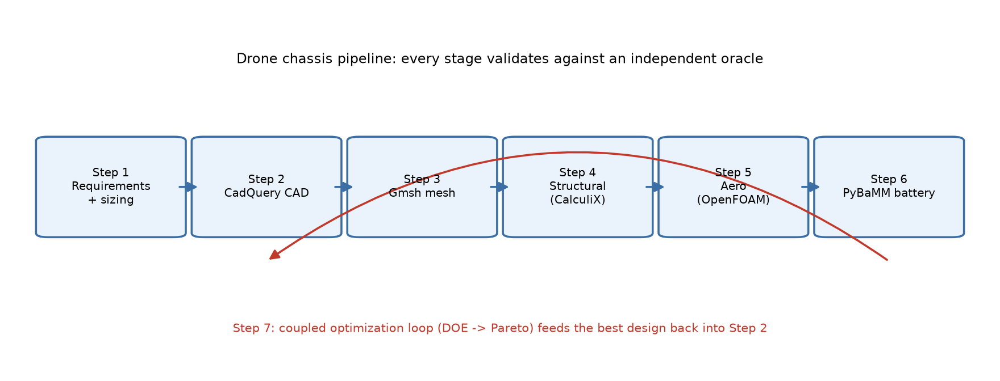

# Architecture

## Components

| Component | Stage | Input | Output |
|---|---|---|---|
| `core.py` sizing | 1 | `Requirements`, `ArmSection` | `SizingResult` (mass, thrust, hover power) |
| `cad/cad_model.py` | 2 | design parameters | STEP/STL, render, CAD mass + CoG |
| `mesh/mesh.py` | 3 | design parameters | `structural.msh`, `flow.msh`, quality JSON |
| `run_structural.py` | 4 | design parameters, requirements | CalculiX `.inp` decks, stress/deflection/frequency, plots |
| `run_cfd.py` | 5 | design parameters | OpenFOAM case, drag vs speed, correlation validation |
| `battery_sim.py` | 6 | hover/cruise power | flight time, discharge curves, temperature sweep |
| `optimize.py` | 7 | design space bounds | DOE table, Pareto front, selected design |
| `run_all.py` | all | -- | full artefact tree + demo GIF |

## Data flow

1. `Requirements` (payload 500 g, 20 min hover, 15 m/s, TWR >= 2, 450 mm X-frame) enter `first_pass_sizing`, which adds frame mass (tube volume x material density), propulsion set mass (350 g), avionics (120 g), and battery mass (pack Wh / 170 Wh/kg), then computes thrust per motor and electrical hover power with momentum theory (Figure of merit 0.70, electrical efficiency 0.85).
2. The CAD stage rebuilds the same `DesignPoint`, exports geometry, and reports the frame mass (0.362 kg for the baseline carbon arm) so the sizing mass budget can be cross-checked.
3. Meshing regenerates both meshes from the same parameters: 2nd-order tets (2510 elements) for structure, and a refined 2D flow box (18,430 elements).
4. Structural: three static load cases (hover thrust, 2.2x max thrust, 5 g landing x 1.2) produce bending stress at the root; the modal deck plus a Rayleigh-Ritz beam model produce the first bending frequency, checked against the 100-300 Hz motor band.
5. Aerodynamics: frontal-area-based quadratic drag (Cd 1.05) validated by sphere (Clift-Grace-Weber) and cylinder correlations against published values, plus a generated OpenFOAM k-omega SST case with actuator-disk `fvOptions`.
6. Battery: PyBaMM SPMe (Chen2020) per-cell discharge to 3.0 V/cut-off at the equivalent current, over -10/0/25/40 C.
7. Optimization: Latin hypercube over (arm length, outer diameter, wall, material), fast-path evaluation of every design, constraint filtering (SF >= 2, modal separation), and Pareto extraction on (mass, -flight time).

## Feedback edge

The optimizer writes `optimization/optimization_summary.json`; the selected design's parameters re-enter `cad/cad_model.py --arm-length-mm ...` to regenerate the final geometry, closing the loop (Step 8).

